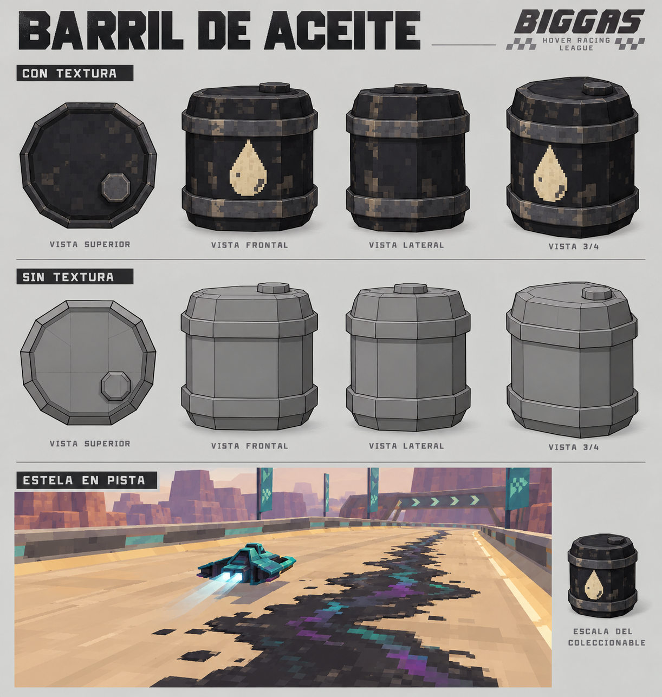

# Barril de aceite — concepto

Reemplaza a Bomba Rebote en la propuesta inicial. El conjunto pasa a ser Chispa, Barril de aceite y Burbuja. La lámina anterior de Rebote se conserva como alternativa histórica.

Barril negro compacto, facetado, con dos aros metálicos y una gota crema pintada. Geometría simple y textura pixelada compatible con Biggas. La lámina es concept art generado con la herramienta integrada de imágenes, no un modelo ni una captura del juego. La escena inferior ilustra la apariencia de la estela; su conexión exacta al emisor y adaptación al circuito se resolverán en el prototipo.

Al activar el ítem, la nave vierte aceite hacia atrás durante 2 segundos. La estela se apoya sobre la superficie de la pista y cada tramo permanece 6 segundos antes de desvanecerse. Reduce la velocidad un 30% mientras se atraviesa; al salir, la nave recupera velocidad gradualmente. No acumula penalizaciones por superposición de manchas. Burbuja evita la ralentización mientras está activa. Todos estos valores son iniciales para probar, no balance definitivo.

La estela debe dejar espacio para esquivar, ser legible de día y de noche, seguir pendientes y no crear segmentos suspendidos sobre huecos. El ancho se ajustará respecto a la nave. En DialKit: tamaño del barril, ancho de estela, tiempo de vertido, permanencia, ralentización y recuperación.

Stage 3 actualizado: recoger el barril, activar el vertido, ver la estela y volver a atravesarla para probar ralentización y recuperación. Después comprobar interacción con Burbuja, pausa, reinicio y limpieza de manchas. Primero resolver la mecánica con geometría simple; luego aplicar el modelo y texturas finales.
