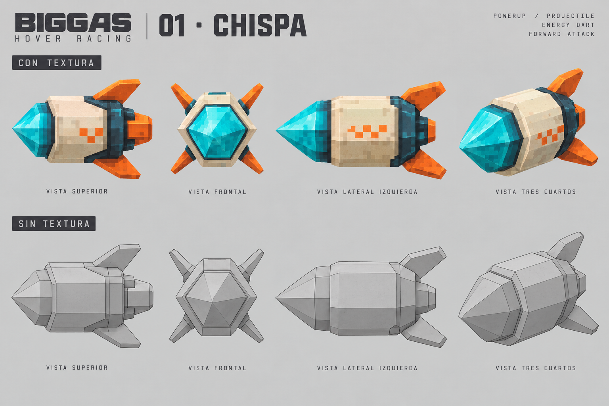
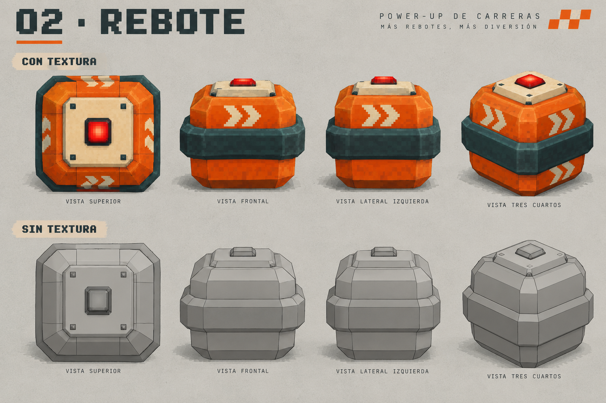
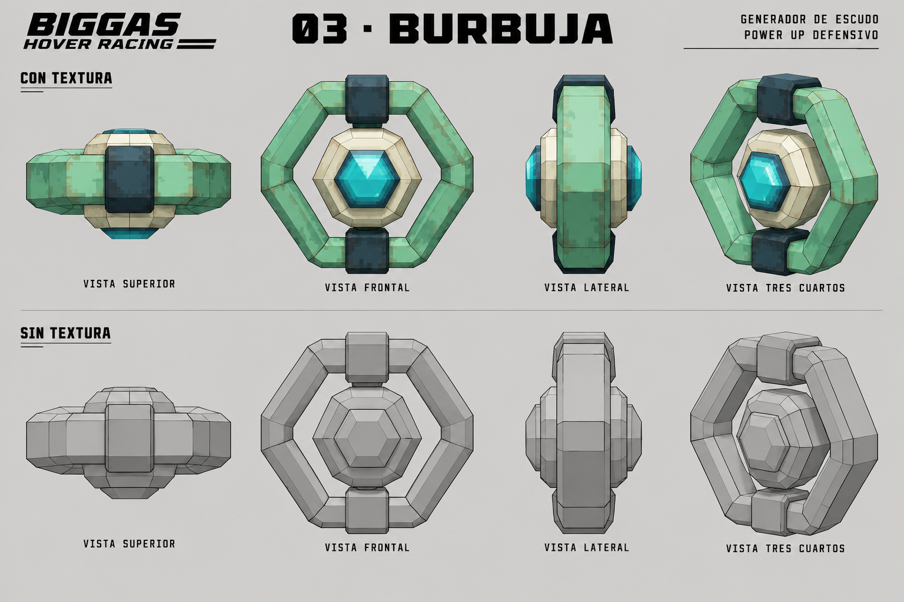

# Biggas — primeros tres ítems

Propuesta para revisar y probar por etapas. Las imágenes son conceptos generados, no modelos 3D ni funciones implementadas. Generadas con la herramienta integrada de imágenes; prompts completos en prompts.json.

## Dirección visual

Props low-poly de silueta clara, texturas pixeladas y acabado cómic/papel compatible con Biggas. Chispa es alargado y cian, Rebote es compacto y naranja, Burbuja es un aro verde. El ícono debe distinguirse por forma además de color. Las multivistas orientan el modelado; diferencias menores entre vistas se resuelven al construir el modelo.

## Reglas compartidas propuestas

- Cápsulas flotantes en grupos de tres sobre tramos anchos y visibles de la pista. Evitar salidas de curvas ciegas, saltos y pasos estrechos.
- Al atravesar una cápsula, recoger un ítem si el inventario está vacío. Un solo espacio y un uso por ítem; no sustituir el que ya se lleva.
- Primer prototipo: cada cápsula muestra el ítem que entrega, sin ruleta. Más adelante podemos probar una cápsula aleatoria.
- Usar con Q o un botón táctil. Mostrar ícono, nombre y disponibilidad en el HUD. Pulsar una vez consume una carga.
- Reaparición inicial de cápsulas: 8 segundos. Tamaño inicial: aproximadamente 35% del ancho de la nave, con halo de recogida legible.
- Los impactos reducen velocidad brevemente, sin eliminar al corredor. Ventana inicial de protección tras recibir un golpe: 1,5 segundos para evitar encadenar impactos.
- Pausa congela proyectiles, temporizadores y reapariciones. Reinicio limpia los efectos y el inventario.
- La contrarreloj normal permanece separada del modo de pruebas con ítems; sus tiempos no comparten récords.

## 01 — Chispa: disparo frontal

Un dardo de energía cian con pequeñas aletas naranja. Sale hacia delante y sigue recto, sin perseguir objetivos. Una estela corta permite leer su trayectoria; desaparece al impactar o agotar su alcance.

Valores iniciales de prueba: 55 m/s respecto al mundo, alcance de 80 m, una carga. Impacto: reducir la velocidad del objetivo un 25%, con recuperación de control inmediata y destello breve. No rebota en paredes ni atraviesa sólidos. Ignora al emisor.

Objetivo de la prueba: apuntar debe sentirse predecible incluso al conducir a máxima velocidad. Comprobar detección continua entre posiciones del proyectil para no atravesar blancos o paredes por velocidad.

## 02 — Bomba Rebote: ataque de área

Un dispositivo cúbico naranja con una banda protectora oscura. Se lanza en un arco corto hacia delante, rebota y emite un pulso al terminar una cuenta regresiva visible. El área se anticipa con un anillo en el suelo y una señal sonora creciente.

Valores iniciales: lanzamiento a unos 12 m en una recta plana, hasta dos rebotes, pulso a los 2 segundos, radio de 4 m. Reduce velocidad un 35%. Puede afectar al propio lanzador: la zona señalizada debe darle oportunidad de alejarse. Un objetivo recibe como máximo un golpe por pulso. Desaparece si cae fuera del circuito.

Objetivo de la prueba: entender dónde caerá y poder esquivarla. Ajustar alcance, demora y radio antes de agregar variantes de lanzamiento.

## 03 — Burbuja: defensa

Un generador en forma de aro verde con núcleo cian. Al usarlo envuelve la nave y su piloto con una cubierta translúcida facetada; debe mantener visible la pista, especialmente en cámara a bordo.

Valores iniciales: 5 segundos o un impacto de Chispa/Rebote, lo que ocurra primero. Bloquea la penalización de ese ataque y se rompe con un destello corto. Parpadea durante el último segundo. No protege de caídas ni permite atravesar paredes; no se acumula con otra Burbuja.

Objetivo de la prueba: reconocer claramente cuándo empieza, bloquea y termina la protección.

## Stages y criterios para avanzar

| Stage | Entrega jugable | Qué probar antes de avanzar |
| --- | --- | --- |
| 0 — Concepto | Estas tres láminas y reglas propuestas | Elegir siluetas, colores y funciones |
| 1 — Recoger y usar | Cápsulas simples en un tramo de Ruinas, un espacio en HUD, Q y botón táctil; selector de ítem para pruebas | Recogida a distintas velocidades, inventario lleno, pausa, reinicio y tamaño respecto a la escala ajustable de la nave |
| 2 — Chispa | Primer modelo sencillo, proyectil y blancos de práctica con respuesta visible | Dirección, alcance, colisiones con paredes y blancos, legibilidad en movimiento |
| 3 — Rebote | Trayectoria, rebotes, aviso de área y pulso; blanco móvil de prueba | Caída sobre pista, esquiva, radio, un solo impacto por pulso y efecto sobre el lanzador |
| 4 — Burbuja | Escudo y un emisor de ataques de práctica | Bloquear ambos ataques, duración, consumo de un impacto, cámara a bordo y nave a distintas escalas |
| 5 — Circuito completo | Distribución de cápsulas, modelos y efectos finales, sonido y balance en ambos mapas y naves | Rondas de prueba con los tres ítems, rendimiento, táctil y modo de movimiento reducido |

El juego actual no tiene multijugador ni rivales de carrera. Los blancos y emisores de práctica permiten validar los tres ítems; corredores con IA o multijugador serían una etapa aparte.

## Parámetros para DialKit

Una carpeta «Ítems» con tamaño de cápsula, tiempo de reaparición y selector de ítem de prueba; otra por ítem con velocidad/alcance de Chispa, distancia/demora/radio de Rebote y duración de Burbuja. Separar estos valores de la escala conjunta nave/piloto. Guardar preferencias de prueba y cerrar una configuración estable después de cada stage.

Siguiente paso propuesto: Stage 1 y después Chispa, para validar el ciclo completo de recoger, guardar y usar antes de sumar las otras mecánicas.
